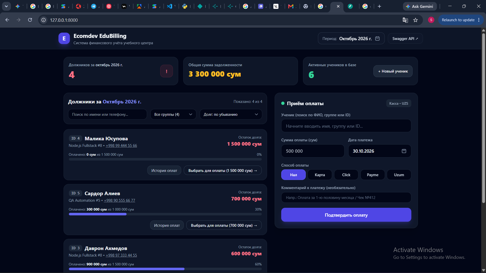
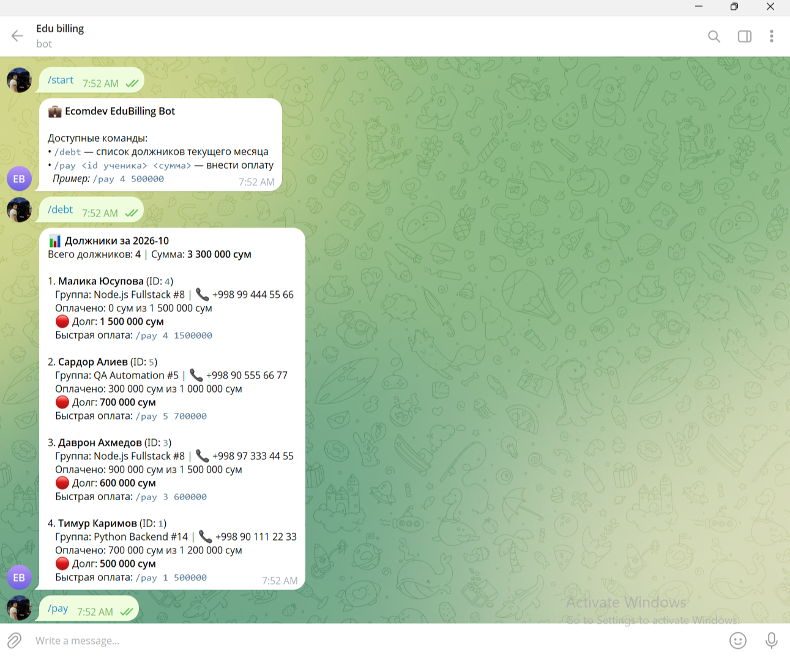

# 💼 Ecomdev EduBilling — Система учёта оплат учебного центра


Тестовое задание (Этап 3) на позицию разработчика в **Ecomdev**.
В проекте реализованы **оба варианта интерфейса** из Части 2 (адаптивный Mobile-First веб-интерфейс кассира + Telegram-бот), подключённые к единому слою бизнес-логики и БД.

---

## 🖼 Превью интерфейсов

### 1. Веб-интерфейс кассира (Вариант Б — Mobile-First FinTech UI)


### 2. Telegram-бот (Вариант А — `/debt` и `/pay <id> <сумма>`)


---

## 🚀 Быстрый запуск проекта с нуля (Часть 3.1)

### Вариант 1: Локальный запуск (Python)
```bash
git clone [https://github.com/samandarolimjonov273/ecomdev-edu-billing.git](https://github.com/samandarolimjonov273/ecomdev-edu-billing.git)
cd ecomdev-edu-billing

python -m pip install -r requirements.txt
python seed.py
python -m uvicorn app.main:app --reload
```
После запуска доступны:
- 🌐 **Веб-касса:** http://127.0.0.1:8000
- 📄 **Swagger API документация:** http://127.0.0.1:8000/docs
- 📥 **Экспорт должников в CSV (Excel):** `GET /debtors/export?month=YYYY-MM`

### Вариант 2: Запуск одной командой через Docker Compose
```bash
cp .env.example .env
docker compose up --build
```

### Запуск автотестов (5 тестовых сценариев)
```bash
python -m pytest -v
```

### Запуск Telegram-бота
Бот запускается автоматически в фоновом режиме вместе с FastAPI-сервером (при наличии `TELEGRAM_BOT_TOKEN` в `.env`), либо отдельно командой:
```bash
python -m bot.telegram_bot
```
Команды бота:
- `/debt` — список должников текущего месяца с расчётом остатка долга.
- `/pay <id ученика> <сумма>` — мгновенное внесение оплаты (например: `/pay 5 500000`).

---

## 📡 Архитектурные особенности
- **Оптимизация `GET /debtors?month=YYYY-MM` без проблемы N+1:** Расчёт задолженностей выполняется **единым агрегирующим SQL-запросом** (`LEFT OUTER JOIN` + `GROUP BY` + `COALESCE(SUM(...), 0)`), что гарантирует мгновенный отклик при росте базы учеников.
- **Точность финансовых вычислений:** Все денежные суммы хранятся и агрегируются в типе `Decimal` (`Numeric(12, 2)`), исключая ошибки округления `float`.
- **Production UX/UI:** Реализован Searchable Combobox с чипом выбранного ученика, маска разрядов суммы (`500 000`), независимое от локали ОС отображение дат (`ДД.ММ.ГГГГ`), фильтрация по группам, выбор способа оплаты (`Нал`, `Карта`, `Click`, `Payme`, `Uzum`) и выгрузка отчёта в CSV/Excel.

---

## 🛠 Что бы я улучшил, будь у меня ещё неделя (Часть 3.2)

1. **Историчность тарифов и биллинг-периодов (Tariff Snapshots & Accruals):**
   Сейчас изменение `monthly_fee` у ученика меняет порог расчёта и для прошлых месяцев. За дополнительную неделю я бы внедрил таблицу ежемесячных начислений (`invoices`), чтобы фиксировать тариф ученика на конкретный месяц, поддерживать индивидуальные скидки, заморозку обучения и автоматический перенос переплаты (аванса) на следующий месяц.
2. **Идемпотентность платежей и защита от двойного списания (`Idempotency-Key`):**
   При нестабильном мобильном интернете кассир или Telegram-бот может отправить `POST /payments` дважды. Я бы добавил заголовок `Idempotency-Key` и транзакционные блокировки (`SELECT ... FOR UPDATE`), чтобы гарантировать 100% защиту от дублей платежей.
3. **Миграции БД (Alembic) и Audit Log (Журнал финансового аудита):**
   Подключил бы `Alembic` для версионирования схемы PostgreSQL и таблицу `audit_logs`, фиксирующую кто, когда и с какого IP/Telegram-аккаунта изменил тариф ученика, удалил карточку или провёл оплату.
4. **Автоматические уведомления должникам (Celery / APScheduler):**
   Добавил бы фоновый планировщик, рассылающий вежливые напоминания должникам в Telegram/SMS 25-го числа каждого месяца, а также генерацию PDF-квитанций об оплате.
5. **Ролевая модель доступа (RBAC) и JWT-авторизация:**
   Разделил бы права доступа между ролями `Администратор` (управление тарифами, удаление учеников), `Кассир` (приём оплат, просмотр должников) и `Преподаватель` (просмотр своей группы).
```